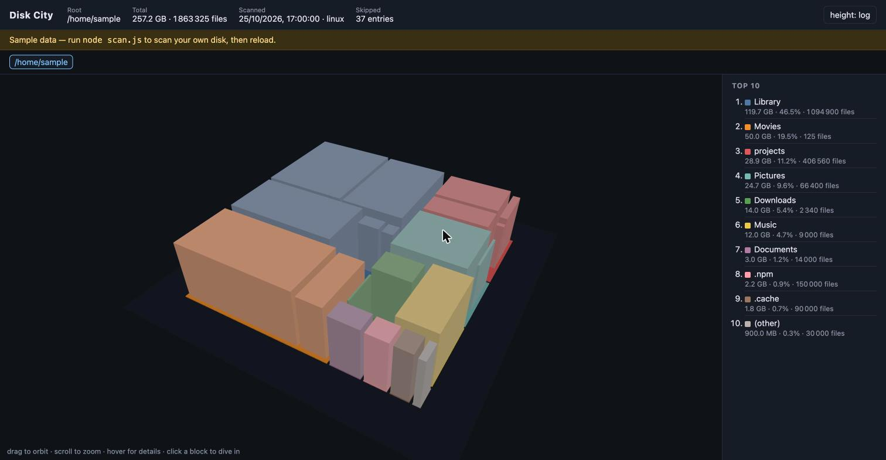

# Disk City

A CLI that scans a folder and a web viewer that draws the result as a 3D city:
every directory is a building, its footprint is its share of bytes, its height
is `log(bytes)`. Hover for the path and size, click a block to dive in, use the
breadcrumb to come back.

Live demo (sample data, published from `main`): **https://marujinho.github.io/disk-space-3d/**



Built in about an hour for a "build any small app with AI" brief. Plain
JavaScript (ESM), Node ≥ 20, runs on Linux, macOS and Windows — and CI proves
that last part on all three.

## Quick start

```sh
node scan.js              # scans your home dir -> viewer/public/scan.json
npm run dev               # serves the viewer on http://127.0.0.1:5173
```

Nothing to install. The scanner and the dev server use only Node built-ins,
and the viewer's two libraries are vendored in `viewer/vendor/`. Any static
file server pointed at `viewer/` works too; opening `index.html` straight from
disk doesn't, because browsers block `fetch` from `file://`.

Scan something smaller first if you want a quick look:

```sh
node scan.js ~/projects --depth 3
```

Without a `scan.json` the viewer shows the committed sample and says so in a banner.

## CLI

```
node scan.js [dir] [--depth N] [--min FRACTION] [--out PATH]
```

| Flag | Default | Meaning |
|---|---|---|
| `dir` | your home directory | Directory to scan |
| `--depth` | `3` | Directory levels kept in the output. Deeper bytes still count toward their ancestors |
| `--min` | `0.001` | Siblings under this share of the total are merged into one `(other)` node, so sums stay exact |
| `--out` | `viewer/public/scan.json` | Where the JSON goes |

Progress goes to stderr every 10 000 files. Exit code is 1 only for bad
arguments or an unreadable root; permission errors inside the tree are counted,
not fatal.

## JSON contract (scanner → viewer)

```json
{
  "root": "C:\\Users\\acacio",
  "platform": "win32",
  "scannedAt": "2026-10-25T21:30:00.000Z",
  "totalBytes": 412000000000,
  "files": 1530505,
  "skipped": 1203,
  "nodes": [
    { "name": "AppData", "bytes": 98000000000, "files": 412000, "children": [] }
  ]
}
```

Nodes carry a `name` only, never a full path. The viewer rebuilds paths from
the tree, which sidesteps separator differences between platforms.

## How it's drawn

- `d3-hierarchy` lays the current level out as a squarified treemap on a fixed
  100×100 ground. Top-level directories are coloured **blocks**; their children
  are the **buildings** inside. A directory with no subdirectories is drawn as a
  single building.
- Height is `log1p(bytes) / log1p(max)` by default so a 40 GB folder doesn't
  flatten everything else. The header button switches to linear.
- Ground left empty inside a block is files living directly in that directory.
- One `three.js` mesh per building, no shadows. Depth 3 plus the 0.1 % cut
  keeps a home-directory scan well under 1 000 meshes.

## Tests and CI

```sh
npm test          # node:test — scanner, dev server, layout math; no install, no browser
```

`.github/workflows/ci.yml` runs on every push and pull request:

- **test** on `ubuntu-latest`, `macos-latest` and `windows-latest`: `npm test`,
  then a real `node scan.js .` on the runner. The matrix is the point — it
  exercises `path.join`, symlink skipping and the permission-error handling on
  each OS, not just that the code parses.
`.github/workflows/pages.yml` deploys `viewer/` as-is, with the sample data, to
GitHub Pages on every push to `main`. One-time setup if the first run says
"Resource not accessible by integration": Settings → Pages → Source → *GitHub
Actions*, then re-run the workflow.

Tests build their fixture trees in `os.tmpdir()`. The symlink test skips itself
on Windows when symlink creation needs Developer Mode, and the unreadable-dir
test skips on Windows (no `chmod 000`) and when running as root.

## Known limits

- **Logical size, not on-disk size.** `stat().size` ignores APFS/NTFS
  compression, sparse files and block rounding. Totals will differ from
  Finder/Explorer.
- **Symlinks, junctions and OneDrive placeholders are skipped**, silently. On
  Windows reparse points show up as symlinks, which is what stops the scanner
  double-counting or hanging on cloud placeholders.
- **macOS without Full Disk Access** can't read parts of `~/Library`; those
  show up in `skipped`, the scan still completes.
- **`scan.json` is yours.** It contains your directory names. It's gitignored;
  don't commit it. `scan.sample.json` is synthetic.

## Left out on purpose

| Not here | Why |
|---|---|
| Per-file view | The contract is a depth-3 directory tree; files are counted, not listed. Keeps the mesh count bounded |
| On-disk / allocated size | Needs platform syscalls; out of a one-hour JS toy |
| Delete / reveal in Finder | A read-only tool stays read-only |
| ESLint / Prettier | Three source files and a test runner. The cross-OS test matrix is the quality gate; a linter is a ten-minute add when there's a second contributor |
| TypeScript, React | The brief allowed either; I wanted as much plain JavaScript as possible. The viewer is vanilla `three` + `d3-hierarchy`, vendored and loaded through an import map. No bundler, no `node_modules` |
| Keyboard navigation of the canvas | The breadcrumb and top-10 list are plain DOM and keyboard-reachable; the 3D canvas isn't |
| Comparing two scans | Nice, not small |

## How AI was used

The whole thing was built with Claude Code driving a small pipeline that lives
in `.claude/` (PRD → plan → implement → review). The PRD and plan it produced
are in `docs/work/`. Places where the original scope (`scope.md`) was
overridden, and why:

- **React Three Fiber → vanilla three.js.** The scope said R3F; the person
  asked for as much plain JavaScript as possible. Fewer dependencies, same
  picture.
- **`node scan.js … || node scan.js …` → `${{ runner.temp }}`.** The scope's
  own second thought; one line that works on all three runners.
- **Vite → no build step.** The first version bundled with Vite. It was
  dropped for vendored libraries, an import map and a 100-line dev server, so
  the repo has no dependencies at all.
- **Dev-server fallback.** Some static servers answer unknown paths with
  `index.html` and a 200, so "no `scan.json`" has to mean "non-OK *or*
  non-JSON". Found by probing Vite's server, not by reading docs.
- **Layout is a pure module.** Treemap maths, path rebuilding and validation
  live in `viewer/src/layout.js` so they run under `node:test`; only the
  three.js and DOM code is verified by hand.

## License

MIT
